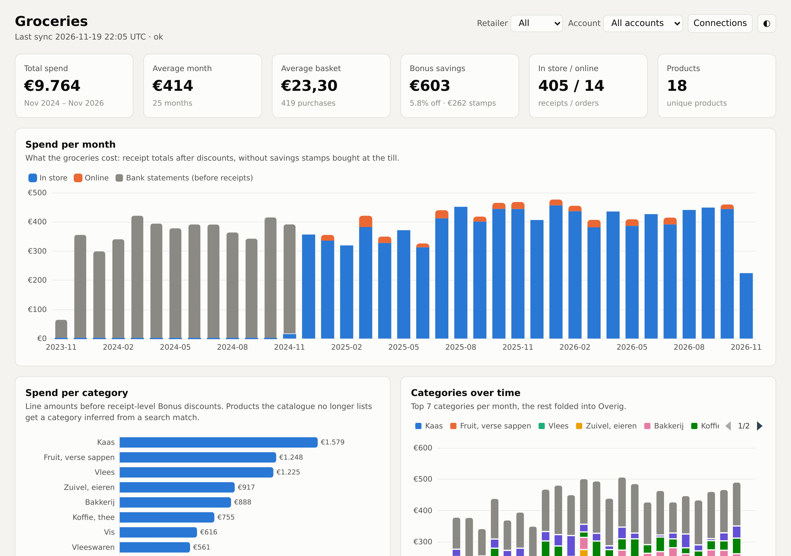
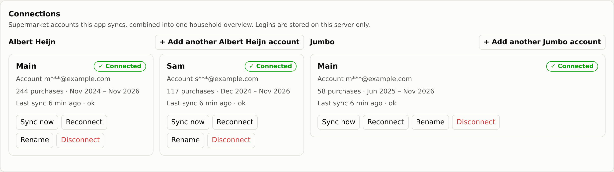

# dutchgroceries

Self-hosted purchase history for the Dutch supermarkets **Albert Heijn** and **Jumbo**. It syncs your
receipts and online orders to your own machine, keeps them in SQLite (plus the raw JSON), and shows a
dashboard: where the money goes, what you buy most, and how the prices of the things you actually buy
change over time.

> **Unofficial. Not affiliated with Albert Heijn, Ahold Delhaize or Jumbo.** This project talks to the
> undocumented APIs behind the retailers' own apps. They can change or disappear at any time. Use it for
> your own accounts and for personal use only, keep the request rate low, and use it at your own risk.

<picture>
  <source media="(prefers-color-scheme: dark)" srcset="docs/screenshot-dark.png">
  
</picture>

*Screenshots show made-up demo data (`groceries demo-seed`).*

## Contents

- [Features](#features)
- [Quick start](#quick-start)
- [Upgrading](#upgrading)
- [Connecting Albert Heijn and Jumbo](#connecting-albert-heijn-and-jumbo)
- [Configuration](#configuration)
- [Running behind a reverse proxy](#running-behind-a-reverse-proxy)
- [Scheduling the sync](#scheduling-the-sync)
- [Notifications](#notifications)
- [History before your receipts](#history-before-your-receipts)
- [Commands](#commands)
- [Data and privacy](#data-and-privacy)
- [Limitations](#limitations)
- [FAQ and troubleshooting](#faq-and-troubleshooting)
- [Debugging](#debugging)
- [Contributing, security, license](#contributing-security-license)

## Features

- **Albert Heijn**: every in-store receipt AH still keeps (27 months) and your online orders, with
  products matched to AH's catalogue for title, brand and category.
- **Jumbo**: digital store receipts (for visits where your Jumbo Extra's card or app was scanned).
- **Incremental daily sync**, and an archive that outlives the retailer's: once synced, a receipt stays
  even after the retailer deletes it.
- **Dashboard** (light and dark, works on a phone): spend per month and per category, store vs online,
  top products, price history per product with a regular-price line built from your own receipts,
  biggest price changes, a personal price index, Bonus and discount savings, basket size, stores,
  recent purchases.
- **Drill down**: click any bar, store or shelf-price row to see the products and receipts behind it.
- **Time range**: look at the last week, month, quarter, year or 2 years, or all time. Every tile, chart
  and table follows the selection; it is kept in the URL (`?range=quarter`), so a view can be bookmarked.
- **Connect from the browser**: a card per account with Connect, Sync now, Reconnect, Rename and Disconnect.
  Your password never reaches this app.
- **A whole household**: connect several Albert Heijn or Jumbo accounts (yours, your partner's) and see
  them together, or filter the dashboard to one account.
- **Optional extras**: public shelf prices since November 2022 for the products you buy, supermarket
  payments from a bank CSV export (for the years before your receipts), and ntfy or webhook alerts when
  a sync starts failing.
- **Multi-retailer by design**: providers are plugins; see [docs/adding-a-retailer.md](docs/adding-a-retailer.md).

How the numbers are computed:

- **Spend** is what you paid, minus savings stamps (koopzegels) bought at the till. Those come back
  later as a payment, so counting them would count the same money twice.
- **Category and product spend** use line amounts before Bonus discounts: AH deducts most discounts
  from the receipt total, not per item. Savings are shown separately.
- **Price changes** compare the median price of the first and last quarter of your purchases of a
  product (at least 4 purchases, 120+ days apart).

## Quick start

### Docker

```sh
git clone https://github.com/ldanicel/dutchgroceries.git && cd dutchgroceries
cp .env.example .env        # optional: every setting in it is commented out
docker compose up -d --build
```

Open <http://127.0.0.1:8000> and connect a supermarket. The `sync` container syncs on start and then
once a day. To reach the dashboard from other devices, change the published port in `compose.yaml`
(for example `"0.0.0.0:8000:8000"`) and read [Data and privacy](#data-and-privacy) first.

Data lives in the named volume `groceries-data`. If you use a bind mount instead, make the directory
writable for uid 10001: `sudo chown 10001 ./data`.

### Python (venv) with systemd

Requires Python 3.11 or newer and Linux with systemd. The example paths use `/opt/dutchgroceries`.

```sh
sudo useradd --system --no-create-home --shell /usr/sbin/nologin groceries
sudo mkdir -p /opt/dutchgroceries/data /opt/dutchgroceries/secrets
sudo git clone https://github.com/ldanicel/dutchgroceries.git /opt/dutchgroceries/src
sudo python3 -m venv /opt/dutchgroceries/venv
sudo /opt/dutchgroceries/venv/bin/pip install -r /opt/dutchgroceries/src/requirements.lock /opt/dutchgroceries/src
sudo cp /opt/dutchgroceries/src/.env.example /opt/dutchgroceries/config.env
# edit config.env: at least GROCERIES_DATA_DIR=/opt/dutchgroceries/data and
# GROCERIES_SECRETS_DIR=/opt/dutchgroceries/secrets (uncomment the lines)
sudo chown -R groceries: /opt/dutchgroceries/data /opt/dutchgroceries/secrets
sudo cp /opt/dutchgroceries/src/deploy/systemd/groceries-* /etc/systemd/system/
sudo systemctl daemon-reload
sudo systemctl enable --now groceries-web.service groceries-sync.timer
```

The dashboard then runs on <http://127.0.0.1:8000>. The units run as the `groceries` user with systemd
sandboxing, a private umask and no access to anything but the data and secrets directories.

### Just trying it out

```sh
python3 -m venv .venv && .venv/bin/pip install -r requirements.lock .
GROCERIES_DATA_DIR=./demo .venv/bin/groceries demo-seed
GROCERIES_DATA_DIR=./demo .venv/bin/groceries serve
```

`demo-seed` fills an empty data directory with made-up purchases from two made-up Albert Heijn
accounts (*Main* and *Sam*) and one Jumbo account, so you can look around without an account.

## Upgrading

Read [CHANGELOG.md](CHANGELOG.md) first. Your data and logins stay where they are.

### Docker

```sh
cd dutchgroceries
git pull
docker compose up -d --build
docker compose exec web groceries --version
```

`up -d --build` rebuilds the image and recreates the `web` and `sync` containers; the `groceries-data`
volume is kept.

### Python (venv) with systemd

With the paths from the [quick start](#python-venv-with-systemd):

```sh
sudo git -C /opt/dutchgroceries/src pull
sudo /opt/dutchgroceries/venv/bin/pip install -r /opt/dutchgroceries/src/requirements.lock /opt/dutchgroceries/src
sudo systemctl restart groceries-web.service
/opt/dutchgroceries/venv/bin/groceries --version
```

The next run of `groceries-sync.timer` uses the new version; `sudo systemctl start groceries-sync.service`
runs it now. If the units in `deploy/systemd/` changed (see the changelog), copy them again and run
`sudo systemctl daemon-reload` first.

### After an upgrade: re-parsing your purchases

Parser fixes also apply to purchases you synced before the upgrade. The first time `groceries serve` or
`groceries sync` starts with a different version, it re-parses the raw responses it saved for the stored
purchases (no network, no login) and logs what changed, for example
`upgrade: … total 21.88 -> 21.38, 1 lines added, 2 removed`. The dashboard is available meanwhile; a
sync does it before fetching. This happens once per version; the database remembers the last version
that did it, and a downgrade to 1.2.1 or later counts as a change too (older versions do not record it:
after going back to one of those, run `groceries reimport` yourself). Raw files without a stored purchase (for example
left by a sync that failed halfway) are skipped; the next sync fetches those purchases again. If it
stops with an error, the app carries on and tries again on the next start. Single purchases that cannot
be parsed are listed as warnings and not tried again until the next upgrade;
`groceries reimport --dry-run` shows them. Find the messages with `docker compose logs web sync` or
`journalctl -u groceries-web -u groceries-sync`.

To do it yourself instead, set `GROCERIES_AUTO_REIMPORT=false` (the version is then not recorded, so
turning it back on re-parses once more) and run
`groceries reimport --dry-run`, then `groceries reimport` (see [Debugging](#debugging)). With Docker,
prefix the commands with `docker compose exec web`.

## Connecting Albert Heijn and Jumbo

Both apps log in through a page that ends by handing a one-time code to the phone app (`appie://`,
`jumbo://`). A desktop browser cannot open those links, so the dashboard offers a small bookmarklet,
the **connect helper**, that picks the code up and gives it to your dashboard.

1. Open the dashboard, click **Connections** (top right), then **Connect Albert Heijn** or
   **Connect Jumbo**.
2. Once: drag the **Groceries connect helper** button from the dialog to your bookmarks bar.
3. Click **Open … login** and log in on the retailer's page in the new tab. Afterwards the page may look
   stuck or empty. That is expected: it tried to open the phone app.
4. In that same tab, click the **connect helper** bookmark. It takes you back to the dashboard, which
   asks **Connect …?**. Confirm, and the first sync starts.

The steps are the same for both supermarkets. The first Albert Heijn sync fetches 27 months of receipts
and takes a few minutes.

**No bookmarks bar, or the helper did not work?** Use *Paste instead* in the same dialog: open the
browser's developer tools (F12) on the login tab before logging in. After login the **Console** shows a
red line like `Failed to launch 'appie://login-exit?code=…'` (or `jumbo://callbacks/login?code=…`).
Copy that whole line, paste it in the dialog and click **Connect**. Codes expire within minutes.

**Headless servers** can use the command line instead: `groceries login ah` or `groceries login jumbo`
prints the login URL and asks for the pasted redirect. With Docker: `docker compose run --rm web login ah`.

The **Connections** panel shows each account (its name, masked e-mail, last sync and number of
purchases), with **Sync now**, **Reconnect**, **Rename** and **Disconnect** (deletes the stored login;
synced purchases stay). When a login expires, the card says **Needs reconnect** and a banner appears.

### More than one account per supermarket

Click **+ Add another Albert Heijn account** (or Jumbo), give it a name such as *Partner* and log in with
that other account. Your browser is probably still logged in to the first account, and the retailer would
hand out *its* code again, so first log out on ah.nl / jumbo.com, or open the dashboard in a private
window for this. The app refuses a login for a store account that is already connected, and a
**Reconnect** only accepts the account that card belongs to.

<picture>
  <source media="(prefers-color-scheme: dark)" srcset="docs/connections-dark.png">
  
</picture>

All accounts are synced and shown together; pick one in the **Account** menu at the top to see only its
purchases (bank imports are not tied to an account, so they only show under *All accounts*). A receipt
that appears in two accounts is stored once. From a terminal: `groceries login ah --account Partner`.

## Configuration

All settings are environment variables. They can also live in a file that `GROCERIES_ENV_FILE` points
to (the systemd units do this); [`.env.example`](.env.example) lists them all, commented out.

| Variable | Default | Meaning |
|---|---|---|
| `GROCERIES_ENV_FILE` | (none) | File with `KEY=value` lines to load. Real environment variables win. |
| `GROCERIES_DATA_DIR` | `./data` | Database and raw JSON archive. Made private (700). Docker: `/data`. |
| `GROCERIES_SECRETS_DIR` | `<data dir>/secrets` | Retailer logins, directory 700, files 600. |
| `GROCERIES_HOST` | `127.0.0.1` | Address the dashboard listens on. Docker: `0.0.0.0` inside the container. |
| `GROCERIES_PORT` | `8000` | Dashboard port. |
| `GROCERIES_ALLOWED_HOSTS` | (none) | Extra host names to answer to, besides localhost, IP addresses and `GROCERIES_HOST`. |
| `GROCERIES_TRUSTED_PROXIES` | (none) | IPs/CIDRs of a TLS-terminating proxy whose `X-Forwarded-*` headers are trusted. |
| `GROCERIES_BASIC_AUTH` | (none) | `user:password` to require HTTP basic auth. |
| `GROCERIES_AUTH_PROXY_HEADER` | (none) | Require this header (e.g. `Remote-User`) set by an authenticating proxy. Needs `GROCERIES_TRUSTED_PROXIES`: the header only counts on connections from those addresses. |
| `GROCERIES_ECHARTS_URL` | jsDelivr ECharts 5.5.1 | Chart library URL; self-host it to work offline. |
| `GROCERIES_RETAILERS` | (all connected) | Comma-separated retailers for `groceries sync`: `ah`, `jumbo`. |
| `GROCERIES_TZ` | `Europe/Amsterdam` | Timezone for days and months. Applies to purchases synced afterwards; run `groceries sync --full` to redo older ones. |
| `GROCERIES_REQUEST_DELAY` | `0.5` | Seconds between API calls. |
| `GROCERIES_AH_USER_AGENT` | `Appie/8.22.3` | User-Agent the Albert Heijn app API expects. |
| `GROCERIES_AUTO_REIMPORT` | `true` | Re-parse the saved purchases once after an upgrade (see [Upgrading](#upgrading)). |
| `GROCERIES_PUBLIC_PRICES` | `false` | Refresh public shelf prices after each sync (weekly at most; needs git). |
| `GROCERIES_NTFY_URL` | (none) | ntfy topic URL for alerts. |
| `GROCERIES_NTFY_TOKEN` | (none) | ntfy access token, if your server needs one. |
| `GROCERIES_NTFY_PRIORITY` | `high` | Priority of failure alerts. |
| `GROCERIES_WEBHOOK_URL` | (none) | URL that receives alerts as a JSON POST. |
| `GROCERIES_ALERT_FAIL_TITLE` | `⚠ {retailer} sync failed{account}` | Failure title; `{retailer}`, `{reason}` and `{account}` (" (Partner)") are filled in. Without `{account}` the account name is appended. |
| `GROCERIES_ALERT_RESOLVED_TITLE` | `✅ Resolved: {retailer} sync{account}` | Recovery title. |
| `GROCERIES_SYNC_INTERVAL` | `86400` | Docker only: seconds between syncs in the `sync` container. |

## Running behind a reverse proxy

To use a name like `https://groceries.example.com` through a TLS-terminating proxy (Caddy, nginx,
Traefik), set:

```sh
GROCERIES_ALLOWED_HOSTS=groceries.example.com
GROCERIES_TRUSTED_PROXIES=192.0.2.10      # the address the proxy connects from
```

Without `GROCERIES_ALLOWED_HOSTS` the app refuses the name (HTTP 421): it only answers to names you
list, which protects against DNS rebinding. Without `GROCERIES_TRUSTED_PROXIES` it does not know the
page is https, so login cookies and same-origin checks fail. Open the dashboard through the name you will
use when you drag the connect helper: the bookmarklet points at the address you got it from.

If anyone besides you can reach the proxy, put authentication in front (`GROCERIES_BASIC_AUTH`, or an
authenticating proxy plus `GROCERIES_AUTH_PROXY_HEADER`, which also needs `GROCERIES_TRUSTED_PROXIES`).

## Scheduling the sync

- **Docker**: the `sync` service runs `groceries sync` on start and then every
  `GROCERIES_SYNC_INTERVAL` seconds.
- **systemd**: `groceries-sync.timer` runs it daily at 04:35, with up to 10 minutes of random delay.
- **cron**: for example `35 4 * * * GROCERIES_ENV_FILE=/opt/dutchgroceries/config.env /opt/dutchgroceries/venv/bin/groceries sync`.

A sync only fetches purchases it does not have yet. One receipt that cannot be read is logged and
skipped; the rest still sync.

## Notifications

Optional. With `GROCERIES_NTFY_URL` (and `GROCERIES_NTFY_TOKEN` if needed) or `GROCERIES_WEBHOOK_URL`
set, you get one message when an account's sync starts failing (for example *login needed*) and one when
it works again. Nothing is repeated while the problem lasts. Titles name the account, e.g.
`⚠ AH sync failed (Partner)`; in custom titles use `{retailer}`, `{reason}` and `{account}`.

## History before your receipts

Albert Heijn keeps 27 months of receipts; Jumbo only keeps digital receipts for scanned visits. Two
optional importers fill in earlier years.

**Public shelf prices.** `groceries import-prices checkjebon` samples the git history of the open
[checkjebon](https://github.com/supermarkt/checkjebon) dataset (MIT), which has recorded the listed price
of every product at AH, Jumbo and other Dutch supermarkets almost daily since November 2022. Only the
products you have bought are stored. The price chart then extends back to 2022 (button *All history*)
and a long-term table compares then and now. It needs `git` and about 150 MB of disk. Set
`GROCERIES_PUBLIC_PRICES=true` to extend it automatically after syncs. Listed prices can be a promotion
price on the day, so the app uses the highest listed price per month, and your own receipts always win.

**Bank statements.** `groceries import-bank statement.csv --format ing` reads a CSV you export from
your bank and keeps only the payments to the supermarkets: date, amount and description, no account
numbers. They show up in grey in the monthly spend chart for months before your first receipt, so
nothing is counted twice. Importing the same file again adds nothing. Formats: `ing` (ING
"Af- en bijschrijvingen"), `generic` (`date,amount,description`, negative amounts are payments), or a
mapping JSON file for any other bank (see `src/groceries/importers/bank.py`). The app never contacts a bank.

## Commands

| Command | What it does |
|---|---|
| `groceries serve` | Run the dashboard. |
| `groceries sync [ah] [jumbo] [--account NAME] [--full] [--refresh-products]` | Fetch new purchases for every connected account (or one) and look up new products. |
| `groceries login ah\|jumbo [--account NAME]` | Log in from a terminal. A new name adds an account; without it, the first account. |
| `groceries import-token ah\|jumbo [--account NAME]` | Start from an existing refresh token (read from stdin). |
| `groceries accounts list` | Every store account, its state and number of purchases. |
| `groceries accounts rename NAME NEW` | Rename an account (name or id). |
| `groceries accounts remove NAME [--purge] [--yes]` | Delete an account's login; its purchases stay unless `--purge`, which also deletes their saved raw responses (purges before 1.2.1 left them: a manual `groceries reimport` would add those purchases again). Asks first. |
| `groceries reimport [--provider ah\|jumbo] [--account NAME] [--receipt ID] [--dry-run]` | Re-parse the saved raw responses with the current parser and update the database. No network, no login. A raw file without a stored purchase is added, to `--account` or the retailer's first account. |
| `groceries export-raw --receipt ID [--redact] [-o FILE]` | Print the saved raw response of one purchase, e.g. for a bug report. |
| `groceries import-prices checkjebon [--since 2022-11-01] [--every-days 7] [--full]` | Backfill public shelf prices. |
| `groceries import-bank FILE.csv [--format ing\|generic\|mapping.json]` | Import supermarket payments from a bank CSV. |
| `groceries demo-seed [--months 24]` | Fill an empty data directory with synthetic purchases. |
| `groceries categorize [--dry-run]` | Infer categories for products the retailer gives none (no network). |
| `groceries stats [--range week\|month\|quarter\|year\|2y]` | Print a JSON summary, optionally for a rolling period ending today. |
| `groceries --version` | Print the installed version (also in the dashboard footer and `/healthz`). |

With Docker, run commands in the running container: `docker compose exec web groceries stats`. `login`
is interactive and also works without the dashboard running: `docker compose run --rm web login ah`.

## Data and privacy

- **Everything stays on your machine.** The app only connects to the retailers' APIs, the chart library
  CDN (`GROCERIES_ECHARTS_URL`, pinned by hash), GitHub (only with public prices enabled) and your
  notification endpoints.
- **Logins**: you log in on the retailer's own page; only a one-time code reaches the app. Tokens are
  stored in `GROCERIES_SECRETS_DIR` (700/600), written atomically before use (the retailers rotate them),
  never sent to the browser and never logged.
- **Your data**: the database and raw JSON in `GROCERIES_DATA_DIR` contain your shopping history and
  store visits. Treat backups of it accordingly.
- **The dashboard has no login by default** and listens on 127.0.0.1. If it is reachable from other
  devices, turn on `GROCERIES_BASIC_AUTH` or put an authenticating proxy in front. See [SECURITY.md](SECURITY.md).

## Limitations

- **Unofficial APIs.** Either retailer can change them at any time; a sync then fails with an alert
  until the app is updated.
- **Albert Heijn** keeps 27 months of receipts; older purchases are not available through the app API.
  Online order details are available for delivered orders.
- **Jumbo** only has digital receipts for visits where your Jumbo Extra's card or app was scanned.
  Receipts are parsed from the printed text, so Jumbo products have names but no catalogue categories.
  Jumbo online orders are not imported yet (contributions welcome).
- **Bonus discounts** are deducted on the receipt total, so per-product spend is before discounts.
- Prices of products sold **by weight** vary per pack; the chart says so.

## FAQ and troubleshooting

**The login tab looks stuck after I log in.** That is expected: the retailer tried to open its phone
app. Click the connect helper in that tab.

**The helper shows an orange bar.** Follow its text. "Not logged in" means log in first in that tab.
Otherwise use *Paste instead* with the red `Failed to launch …` line from the browser console.

**"Could not connect: this login was started in another browser".** The code has to come back in the
same browser that clicked *Connect*, within 15 minutes. Start again from the dashboard.

**HTTP 421 "unknown host".** Add the name you use to `GROCERIES_ALLOWED_HOSTS`.

**Buttons do nothing over https / "cross-origin request refused".** Set `GROCERIES_TRUSTED_PROXIES` to
your proxy's address.

**A card says "Needs reconnect".** The retailer no longer accepts the stored login. Click *Reconnect*.

**Docker: permission denied on /data.** With a bind mount, `chown 10001` the host directory.

**Where are the logs?** `docker compose logs` or `journalctl -u groceries-web -u groceries-sync`.

## Debugging

Every sync keeps the retailer's response for each purchase in `<data dir>/raw/<retailer>/<channel>/`
(`store` receipts, `online` orders), exactly as received. When a receipt looks wrong after an update of
the app, re-parse what you already have instead of logging in again:

```sh
groceries reimport --dry-run                  # what would change: receipts, lines added/removed, totals
groceries reimport --provider jumbo           # apply it (only changed receipts are rewritten)
groceries reimport --receipt ID --dry-run     # one receipt (receipt/order id or raw file name)
```

`reimport` also drops catalogue titles that a search matched to the wrong product, so the dashboard shows
the receipt name until the next sync finds a better match. Running it twice changes nothing the second
time. Back up `groceries.db` first if you want to compare. With Docker, prefix the commands with
`docker compose exec web`, for example `docker compose exec web groceries reimport --dry-run`.

A Jumbo receipt whose lines do not add up to its total is logged as
`Jumbo receipt <id>: lines add up to … but the receipt total is …`.

**Sharing a receipt in an issue.** Raw files contain your receipt and member ids, card details and
store. Export a redacted copy and attach that:

```sh
groceries export-raw --receipt ID --redact -o receipt.json
```

`--redact` replaces transaction, order, member and card ids with stable pseudonyms, blanks store and
delivery addresses and store names, masks the receipt header, the card slip and the footer of printed
receipts, and drops barcodes and loyalty balances. Product names and amounts stay: they are what a parser
fix needs. Read the file before you post it. A maintainer can drop it into
`<data dir>/raw/<retailer>/<channel>/` and run `groceries reimport` to reproduce the problem.

## Contributing, security, license

- [CONTRIBUTING.md](CONTRIBUTING.md): development setup (also as a dev container), tests, code style.
- [docs/architecture.md](docs/architecture.md) and [docs/adding-a-retailer.md](docs/adding-a-retailer.md).
- [SECURITY.md](SECURITY.md): reporting vulnerabilities, running it safely.
- [CHANGELOG.md](CHANGELOG.md).

Thanks to [appie-go](https://github.com/gwillem/appie-go), [jumbo-mcp](https://github.com/Robert-SD/jumbo-mcp)
and [jumbo-cli](https://github.com/DanielOostdam-Create/jumbo-cli), whose notes on the retailers' APIs
helped, and to [checkjebon](https://github.com/supermarkt/checkjebon) for the open price data.

MIT licensed, see [LICENSE](LICENSE).
